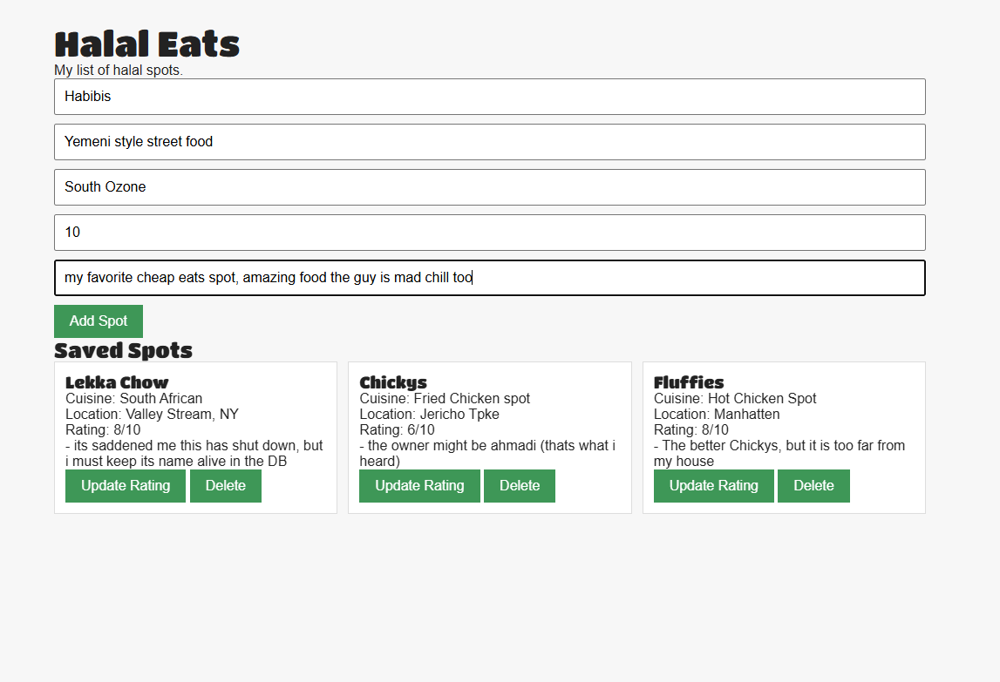

# Halal Eats

My personal list of halal food spots, built so I stop forgetting the good ones. Add a spot, rate it, keep notes on it, and pull the whole list up from anywhere.

## What it does

- Add a spot with a name, cuisine, neighborhood, rating, and notes
- See every saved spot as a card on one page
- Update a rating in place, without retyping the whole spot
- Delete a spot when it shuts down or falls off (RIP Lekka Chow)

## Stack

- Node.js and Express for the server
- MongoDB Atlas for the database, through the native MongoDB driver
- EJS for the pages
- Plain CSS, responsive: one column on phones, two on tablets, three on desktop
- dotenv, so the database string stays out of the code

## How the CRUD works

- Create: the form posts to /spots and the server saves the whole form as one document with insertOne
- Read: the home route pulls every spot with find().toArray() and hands the array to the EJS template
- Update: the button sends a fetch PUT with the spot's id and the new rating; the server runs findOneAndUpdate with $set, so only the rating changes
- Delete: same idea, a fetch DELETE with the id, and findOneAndDelete removes exactly that one

One detail that matters: the server needs two body translators. express.urlencoded() reads normal form posts, and express.json() reads the JSON that fetch sends. Miss the second one and updates arrive with an empty body.

## Run it locally

1. Clone this repo
2. Run npm install
3. Make a .env file with your own Atlas string: MONGO_URI=your-connection-string
4. Run npm start
5. Open http://localhost:3000
